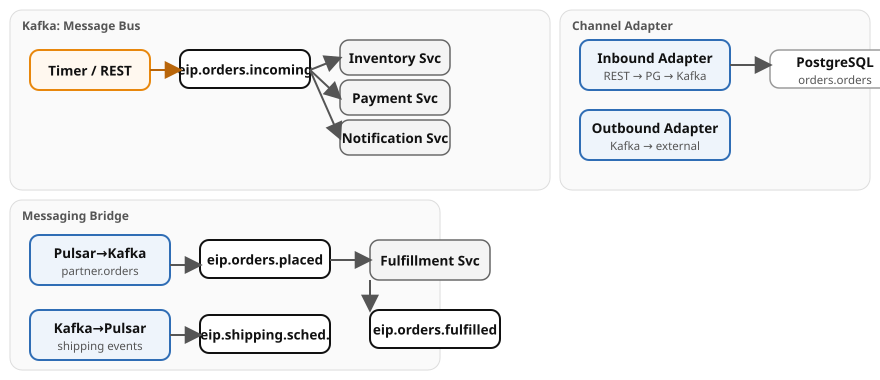

# Chapter 6: Channel Infrastructure

Demonstrates channel-level infrastructure patterns with Apache Camel. Both **Quarkus** and **Spring Boot** runtimes are provided — the Camel route logic is identical; only class annotations and configuration differ.

- **Channel Adapter (Inbound)** — REST endpoint accepts HTTP orders, persists to PostgreSQL, publishes to Kafka — bridges non-messaging to messaging
- **Channel Adapter (Outbound)** — Kafka consumer dispatches fulfilled orders to an external shipping API (simulated)
- **Messaging Bridge** — bidirectional Kafka↔Pulsar bridge: partner orders flow Pulsar→Kafka, shipping events flow Kafka→Pulsar
- **Message Bus** — Kafka as shared bus with three independent consumer groups (inventory, payment, notification) subscribing to the same topic

## Running

```bash
# Start the full infrastructure stack
./scripts/setup-stack.sh

# Quarkus
cd examples/06-channel-infra/quarkus
mvn quarkus:dev

# Spring Boot
cd examples/06-channel-infra/spring-boot
mvn spring-boot:run

# YAML DSL (Camel CLI — no Maven required)
cd examples/06-channel-infra/yaml-dsl
camel run * --port=8082   # REST port is a CLI flag; 8080 is Pulsar's
```

> **Note:** The YAML DSL variant includes only the declarative EIP routes. Data generators and Java-specific patterns (custom aggregation strategies, CDI beans) remain in the Quarkus and Spring Boot variants.

## Infrastructure

Requires Kafka, Pulsar, and PostgreSQL from the compose stack.

## Data flow



## What to observe

1. **Demo data generator** producing orders every 5 seconds to `eip.orders.incoming`
2. **Message Bus** — inventory, payment, and notification services each consuming independently
3. **Fulfillment** consuming bridged orders and producing to `eip.orders.fulfilled`
4. **Outbound Adapter** dispatching fulfilled orders to the external shipping API
5. **Messaging Bridge** forwarding partner orders from Pulsar to Kafka and shipping events from Kafka to Pulsar

Open Kafka UI at [http://localhost:8090](http://localhost:8090) to inspect topics and consumer groups.

## How to test

Submit an order via the inbound channel adapter:

```bash
curl -X POST http://localhost:8082/api/orders \
  -H 'Content-Type: application/json' \
  -d '{"order_id": 999, "item": "WIDGET-042", "quantity": 3, "status": "NEW"}'
```

## Kafka topics

| Topic | Description |
|-------|-------------|
| `eip.orders.incoming` | Orders from REST adapter or timer |
| `eip.orders.fulfilled` | Fulfilled orders from fulfillment service |
| `eip.orders.bridged` | Orders after Pulsar-to-Kafka bridge |
| `eip.orders.placed` | Partner orders bridged from Pulsar |
| `eip.shipping.scheduled` | Shipping events bridged to Pulsar |

## Pulsar topics

| Topic | Description |
|-------|-------------|
| `persistent://public/default/partner.orders.placed` | Inbound from partner systems |
| `persistent://public/default/eip.shipping.scheduled` | Outbound to partner systems |

## PostgreSQL tables

| Table | Description |
|-------|-------------|
| `orders.orders` | Orders persisted by inbound channel adapter |

---

*Verification status: both variants build against Camel 4.22.1 (Quarkus 3.40.1 / Spring Boot 4.1.1); the chapter footer records the integration-test result on Docker Engine (2026-10-09).*
