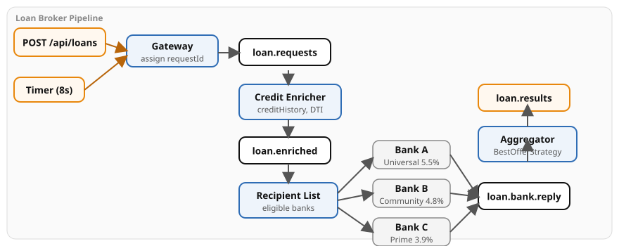

# Loan Broker Case Study (Appendix J)

Scatter-Gather implementation using Apache Camel. A loan request enters
via REST or a timer-generated demo, is enriched with credit bureau data, fanned out
to eligible banks via a Recipient List, and the best offer is selected by an
Aggregator that picks the lowest approved interest rate. Both **Quarkus** and **Spring Boot** runtimes are provided — the Camel route logic is identical; only class annotations and configuration differ.

## Architecture



## Running

```bash
# Start the infrastructure stack (Kafka required)
./scripts/setup-stack.sh

# Quarkus
cd examples/loan-broker/quarkus
mvn quarkus:dev

# Spring Boot
cd examples/loan-broker/spring-boot
mvn spring-boot:run
```

## Infrastructure

Kafka (KRaft mode) only.

## How to test

Submit a loan request. **The path differs by runtime** — Quarkus serves the
gateway at the root, while the Spring Boot variant runs under camel-servlet,
whose default mapping puts it beneath `/camel`:

```bash
# Quarkus
curl -X POST http://localhost:8082/api/loans \
  -H "Content-Type: application/json" \
  -d '{"customerId":"CUST-042","amount":250000,"termMonths":360,"creditScore":740}'

# Spring Boot
curl -X POST http://localhost:8082/camel/api/loans \
  -H "Content-Type: application/json" \
  -d '{"customerId":"CUST-042","amount":250000,"termMonths":360,"creditScore":740}'
```

Either returns `202 Accepted` with the generated `requestId`; the winning offer
is logged by `loan-offer-aggregator` and published to the `loan.results` topic.

Returns HTTP 202 with `{"status": "ACCEPTED", "requestId": "..."}`. Watch the
application logs to see credit enrichment, individual bank quotes, and best-offer
selection. The demo timer also generates a loan request every 8 seconds
automatically with random customers (CUST-NNN), amounts (50k--500k), and credit
scores (580--800).

Bank eligibility rules:

- **Bank A** (Universal Lender, base 5.5%) -- accepts all applicants
- **Bank B** (Community Credit Union, base 4.8%) -- creditScore >= 650 and amount <= 500k
- **Bank C** (Prime National, base 3.9%) -- creditScore >= 720

You can also inspect Kafka topics via the Kafka UI at <http://localhost:8090>.

## Kafka topics

| Topic              | Description                                                        |
|--------------------|--------------------------------------------------------------------|
| `loan.requests`    | Incoming loan requests                                             |
| `loan.enriched`    | Requests enriched with credit bureau data (creditHistory, debtToIncome) |
| `loan.bank.reply`  | Individual bank quote responses                                    |
| `loan.results`     | Best-offer result after aggregation                                |

## Patterns demonstrated

1. **Messaging Gateway** -- REST POST accepts requests and publishes to Kafka (`/api/loans` on Quarkus, `/camel/api/loans` on Spring Boot)
2. **Content Enricher** -- credit-enricher simulates credit bureau lookup, adds creditHistory years and debtToIncome ratio headers
3. **Recipient List** -- dynamically builds eligible bank list based on creditScore and amount thresholds
4. **Scatter-Gather** -- fans out to multiple banks in parallel and collects responses
5. **Aggregator** -- BestOfferStrategy picks the lowest interest rate among approved quotes (10s timeout)
6. **Content-Based Router** -- bank eligibility filtering by score and amount
7. **Pipes and Filters** -- sequential processing pipeline: gateway → enricher → scatter → aggregate
8. **Message Channel** -- Kafka topics connect each stage
9. **Message Endpoint** -- each route is a consumer endpoint
10. **Point-to-Point Channel** -- each bank gets its own request
11. **Request-Reply** -- banks respond with quotes
12. **Return Address** -- requestId header tracks the conversation
13. **Correlation Identifier** -- requestId correlates bank replies for aggregation

---

*Verification status: **both runtimes verified end to end** against the compose stack on 2026-09-17 (Quarkus 3.39.3 / Spring Boot 4.1.1, Camel 4.22.0). A POSTed request returns 202 with its requestId, is enriched with credit data, fans out to all three banks, and the aggregator selects the lowest approved rate and publishes to `loan.results`.*

*The Spring Boot variant had previously only been compiled, and did not in fact work: its gateway returned an empty HTTP 500. `restConfiguration()` sets `bindingMode(json)`, so Camel already serialises the response, and the route marshalled it a second time — which Quarkus tolerated by double-encoding the body and camel-servlet turned into a 500 with no exception logged. The redundant marshal is gone from both runtimes.*
